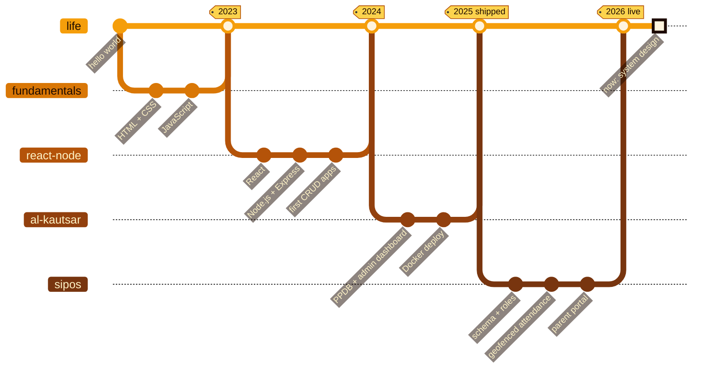
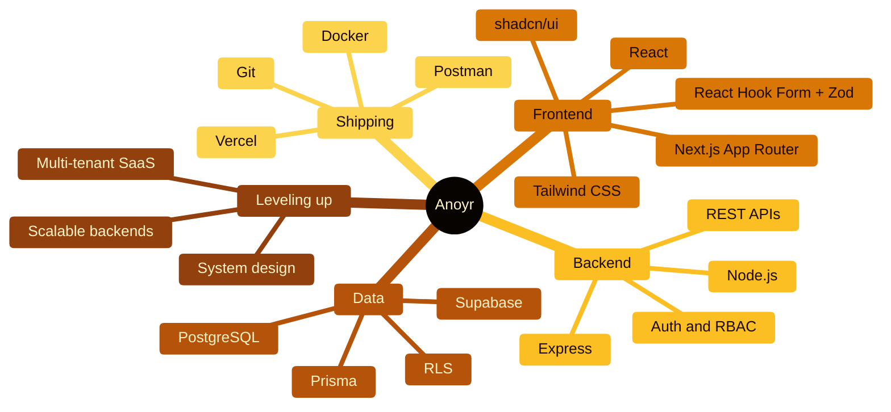
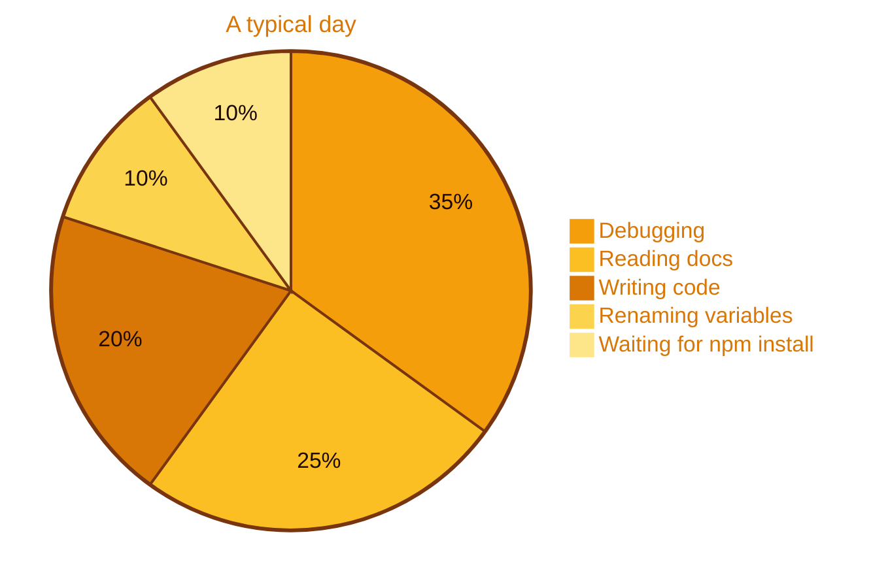
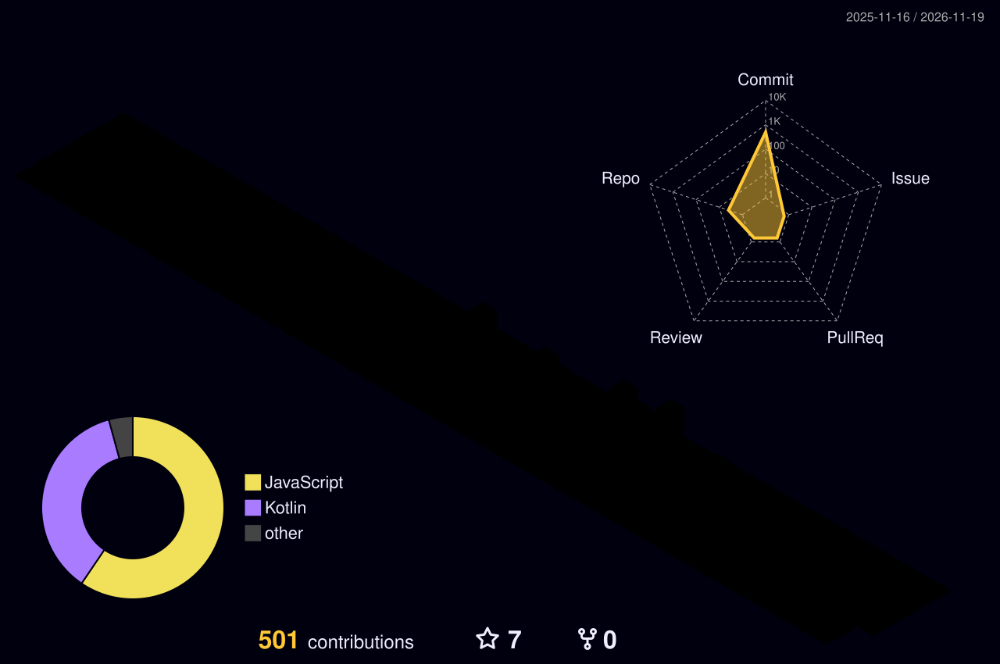

<a name="top"></a>

<div align="center">


<a href="#journey"></a>

<br />

<a href="#contact"></a>
<a href="#journey"></a>
<a href="mailto:daiyanmuslim4@gmail.com?subject=Hi%20Anoyr%20%E2%80%94%20let%27s%20work%20together"></a>
<a href="#projects"></a>

<h3>👋 Halo! I'm <b>Syamzada Daiyan Muslim</b> — <i>a.k.a.</i> <b>Anoyr</b></h3>

<p>Self-taught fullstack developer who builds admin systems that real people actually use.<br />
Right now I'm running <b>SIPOS</b> in production at a pesantren — points, attendance, parents, the works.</p>

<!-- Quick nav -->
<a href="#paths"></a>
<a href="#whoami"></a>
<a href="#journey"></a>
<a href="#skills"></a>
<a href="#projects"></a>
<a href="#now"></a>
<a href="#side-quests"></a>
<a href="#stats"></a>
<a href="#contact"></a>

</div>

<br />


<a name="paths"></a>

## 🧭 Choose Your Path

<sub>Who's visiting? Click the one that fits you — each opens a different side of this profile. 👇</sub>

<details>
<summary><b>🧑‍💼 &nbsp;I'm hiring / a recruiter</b> <sub>— the 10-second TL;DR</sub></summary>
<br />

- **Role** — Fullstack developer: Next.js · TypeScript · Node.js · PostgreSQL
- **Proof** — two systems shipped to production with real users: **SIPOS** and **Website Pesantren Al-Kautsar**
- **Strength** — form-heavy admin systems, granular role-based access, reports people actually need
- **Growing in** — system design & backend architecture
- **Status** — 🟢 open to work

👉 [📧 Email me](mailto:daiyanmuslim4@gmail.com?subject=Opportunity%20for%20Anoyr) &nbsp;·&nbsp; [💼 LinkedIn](https://www.linkedin.com/in/daiyan-muslim-6b03763b5/) &nbsp;·&nbsp; [🚀 See the projects](#projects)

</details>

<details>
<summary><b>🏫 &nbsp;I run a school or pesantren</b> <sub>— meet SIPOS</sub></summary>
<br />

**SIPOS** is already running at a pesantren, and it handles the boring-but-critical stuff:

- 📊 conduct points for santri, plus a **parent portal**
- 📍 staff attendance with **geofencing** — no more *titip absen*
- 📝 leave & sick requests with approval workflow and document proof
- 🌙 night shifts, double shifts, per-day & temporary schedules
- 🩺 UKS health records
- 📄 Excel / PDF export for every report the school actually asks for

I'm exploring whether SIPOS can serve more schools. **Curious?** 👉 [📧 Let's talk](mailto:daiyanmuslim4@gmail.com?subject=SIPOS%20for%20our%20school)

</details>

<details>
<summary><b>👨‍💻 &nbsp;I'm a fellow developer</b> <sub>— let's nerd out</sub></summary>
<br />

Things I'll happily talk about for way too long:

- App Router + RSC patterns for form-heavy admin UIs
- Role-based access that goes beyond `admin | staff`
- PostgreSQL schema design, RLS, and keeping queries fast
- Shipping solo without leaving half-finished side projects behind

👉 [💬 Open an issue to say hi](https://github.com/anoyrCode/anoyrCode/issues/new?title=%F0%9F%91%8B%20Hi%20Anoyr!) &nbsp;·&nbsp; [⭐ Peek at SIPOS](https://github.com/anoyrCode/sipos)

</details>

<details>
<summary><b>🎓 &nbsp;I'm learning to code</b> <sub>— the honest version</sub></summary>
<br />

I started from zero in 2023 — no bootcamp, no CS degree — and now I also teach programming to students. What actually worked for me:

1. **Docs beat endless tutorials.** Most of what I know came from documentation tabs open at 2 AM.
2. **Rebuild it until it stops feeling wrong.** Building one feature three times taught me more than starting ten new ones.
3. **Ship something real.** Real users find edge cases no tutorial ever will.
4. **Finish what you start.** One finished project beats five abandoned repos.

You've got this. 🌱

</details>

<details>
<summary><b>☕ &nbsp;Just browsing</b> <sub>— welcome, grab a coffee</sub></summary>
<br />

Try these while you're here:

- 💻 "run" a few commands in the [terminal](#whoami)
- 🎲 spot the lie in [2 truths & a lie](#side-quests)
- 🐍 watch a snake eat my contributions in [stats](#stats)
- 🗺️ drag the map around in [base camp](#contact)
- 🥚 there's an easter egg somewhere near the bottom…

</details>

<p align="right"><a href="#top"><sub>↑ back to top</sub></a></p>


<a name="whoami"></a>

## 💻 `whoami`

```ts
const anoyr = {
  name:       "Syamzada Daiyan Muslim",
  alias:      "Anoyr",
  location:   "East Java, Indonesia 🇮🇩",
  started:    2023,
  stack:      ["Next.js", "React", "Node.js", "TypeScript", "PostgreSQL"],
  focus:      ["Fullstack Apps", "REST APIs", "Admin Systems", "Clean Architecture"],
  shipped:    ["SIPOS", "Website Pesantren Al-Kautsar"],
  currently:  "Building scalable web apps and sharpening backend skills",
  openToWork: true,

  philosophy() {
    return "Clean, functional, made to last — no half-finished side projects.";
  },
} as const;
```

**🖥️ Interactive terminal** — <sub>click any command to "run" it</sub>

<details>
<summary><code>anoyr@east-java:~$ cat origin-story.md</code></summary>
<br />

Self-taught, started from zero in 2023. No bootcamp, no CS degree — just
documentation tabs open at 2 AM and a habit of rebuilding the same feature
three times until it stops feeling wrong. Still doing that, just with
bigger features now.

```text
2023 ──── first "hello world", then HTML/CSS/JS fundamentals
2024 ──── React + Node.js, first real CRUD apps
2025 ──── shipped Website Pesantren Al-Kautsar to production
2026 ──── SIPOS live with real users — points, attendance, payroll data
  └─ now: system design, backend architecture, maybe a product studio
```

</details>

<details>
<summary><code>anoyr@east-java:~$ ls -la ~/projects</code></summary>
<br />

```console
drwxr-xr-x  sipos/                  🟢 production · points, attendance, parent portal, UKS
drwxr-xr-x  pesantren-al-kautsar/   🟢 production · profile site + PPDB admin dashboard
drwxr-xr-x  task-management-api/    🔐 JWT auth + RBAC REST API
drwx------  next-big-thing/         🧪 multi-tenant SIPOS (shhh…)
```

</details>

<details>
<summary><code>anoyr@east-java:~$ git log --oneline -5</code></summary>
<br />

```console
a1f3c9e feat(sipos): geofenced clock-in with honest-override + audit trail
7be42d1 feat(sipos): night shifts, double shifts, per-day schedules
c09d8a4 feat(sipos): leave & sick approval workflow with document proof
4e6b2f0 fix: timezone bug (it's always timezones)
9d71e33 refactor: rename variable for the 3rd time — it finally feels right
```

</details>

<details>
<summary><code>anoyr@east-java:~$ npm run coffee</code></summary>
<br />

```console
> anoyr@2026.11.0 coffee
> node brew.js

☕ Brewing...
✖ Error: ENOCOFFEE — cup is empty. Refill and try again.
```

</details>

<details>
<summary><code>anoyr@east-java:~$ sudo hire anoyr</code></summary>
<br />

```console
[sudo] password for recruiter: ********
✔ Access granted. Opening communication channels...
```

👉 [📧 daiyanmuslim4@gmail.com](mailto:daiyanmuslim4@gmail.com?subject=Let%27s%20work%20together) &nbsp;·&nbsp; [💼 LinkedIn](https://www.linkedin.com/in/daiyan-muslim-6b03763b5/)

</details>

<p align="right"><a href="#top"><sub>↑ back to top</sub></a></p>


<a name="journey"></a>

## 🌿 The Journey — `git log --graph`

<sub>A live Mermaid diagram — hover it to zoom, pan, or open full screen.</sub>



<p align="right"><a href="#top"><sub>↑ back to top</sub></a></p>


<a name="skills"></a>

## 🧰 Skill Set

<table align="center">
  <tr>
    <td align="center" width="96"><a href="https://react.dev"></a><br /><sub><b>React</b></sub></td>
    <td align="center" width="96"><a href="https://nextjs.org/docs"></a><br /><sub><b>Next.js</b></sub></td>
    <td align="center" width="96"><a href="https://www.typescriptlang.org/docs/"></a><br /><sub><b>TypeScript</b></sub></td>
    <td align="center" width="96"><a href="https://nodejs.org/docs/latest/api/"></a><br /><sub><b>Node.js</b></sub></td>
    <td align="center" width="96"><a href="https://expressjs.com"></a><br /><sub><b>Express</b></sub></td>
    <td align="center" width="96"><a href="https://www.postgresql.org/docs/"></a><br /><sub><b>PostgreSQL</b></sub></td>
  </tr>
  <tr>
    <td align="center" width="96"><a href="https://supabase.com/docs"></a><br /><sub><b>Supabase</b></sub></td>
    <td align="center" width="96"><a href="https://www.prisma.io/docs"></a><br /><sub><b>Prisma</b></sub></td>
    <td align="center" width="96"><a href="https://tailwindcss.com/docs"></a><br /><sub><b>Tailwind</b></sub></td>
    <td align="center" width="96"><a href="https://docs.docker.com"></a><br /><sub><b>Docker</b></sub></td>
    <td align="center" width="96"><a href="https://git-scm.com/doc"></a><br /><sub><b>Git</b></sub></td>
    <td align="center" width="96"><a href="https://vercel.com/docs"></a><br /><sub><b>Vercel</b></sub></td>
  </tr>
</table>

<p align="center"><sub>🖱️ every icon is clickable — it opens the docs I basically live in</sub></p>

<details>
<summary><b>⚙️ daily-driver comfort level</b> <sub>(click to expand)</sub></summary>
<br />

| Area | Comfort | Notes |
|---|---|---|
| Frontend (React/Next.js) | `████████░░` | App Router, RSC, form-heavy admin UIs |
| Backend (Node/Express) | `████████░░` | REST APIs, auth, role-based access |
| Database (PostgreSQL) | `██████░░░░` | Schema design, RLS, query tuning |
| DevOps (Docker) | `██████░░░░` | Containerizing what I ship |
| System Design | `████░░░░░░` | ← currently leveling up here |

</details>

<details>
<summary><b>🧠 the skill map</b> <sub>(a zoomable mind map)</sub></summary>
<br />



</details>

<details>
<summary><b>🧪 the supporting cast</b> <sub>(tools I reach for daily)</sub></summary>
<br />

<p align="center">
  
  
  
  
</p>

</details>

<p align="right"><a href="#top"><sub>↑ back to top</sub></a></p>


<a name="projects"></a>

## 🚀 Featured Projects

<table>
  <tr>
    <td width="50%" valign="top">
      <h3>📊 SIPOS — Student Point System</h3>
      
      <p><i>The flagship.</i> Multi-role web app running in production at a pesantren — conduct points, geofenced staff attendance, parent portal, UKS health records, and analytics.</p>
      <p>
        
        
        
        
      </p>
      <a href="https://github.com/anoyrCode/sipos">
        
      </a>
      <details>
      <summary><sub><b>🛠️ what's actually inside</b></sub></summary>
      <ul>
        <li><sub>Geofenced attendance — clock in/out, radius check, honest-override + audit trail</sub></li>
        <li><sub>Granular per-module role permissions, not just admin/staff</sub></li>
        <li><sub>Leave/sick requests with approval workflow + document proof</sub></li>
        <li><sub>Night shifts, double shifts, per-day & temporary schedules</sub></li>
        <li><sub>Excel/PDF export for every report the school actually asks for</sub></li>
      </ul>
      <sub>👇 the architecture diagram is right below this table</sub>
      </details>
    </td>
    <td width="50%" valign="top">
      <h3>🏫 Website Pesantren Al-Kautsar</h3>
      
      <p>Institutional profile website with a full admin dashboard — handles PPDB registration, document export, and internal data management.</p>
      <p>
        
        
        
        
      </p>
      <a href="https://pesantrenalkautsar.id">
        
      </a>
    </td>
  </tr>
  <tr>
    <td width="50%" valign="top">
      <h3>🔐 Task Management API</h3>
      
      <p>RESTful API with JWT authentication, role-based access control, and full CRUD operations. Built with scalability in mind.</p>
      <p>
        
        
        
        
      </p>
      <a href="https://crm-alkautsar.vercel.app">
        
      </a>
    </td>
    <td width="50%" valign="top">
      <h3>🧪 Next up</h3>
      
      <p><sub>Exploring whether SIPOS becomes a product for other schools — multi-tenant architecture, white-labeling, the whole thing. Watch this space.</sub></p>
      <p><sub><i>"Every big project starts as someone's side quest."</i></sub></p>
      <details>
      <summary><sub><b>🔮 what "multi-tenant" would mean</b></sub></summary>
      <ul>
        <li><sub>One codebase, many schools — each with its own data, roles & branding</sub></li>
        <li><sub>Onboarding a new pesantren in minutes, not weeks</sub></li>
        <li><sub>The same reports & exports, tuned per institution</sub></li>
      </ul>
      </details>
    </td>
  </tr>
</table>

### 🔍 Inside SIPOS

```mermaid
%%{init: {'theme': 'base', 'themeVariables': {'fontFamily': 'ui-sans-serif, system-ui, sans-serif', 'primaryColor': '#78350f', 'primaryTextColor': '#fef3c7', 'primaryBorderColor': '#f59e0b', 'lineColor': '#d97706', 'secondaryColor': '#1c0a00', 'tertiaryColor': '#2a1405', 'clusterBkg': '#2a1405', 'clusterBorder': '#b45309', 'titleColor': '#fcd34d', 'edgeLabelBackground': '#1c0a00'}}}%%
flowchart LR
  subgraph core["⚙️ SIPOS core — Next.js + TypeScript"]
    direction TB
    points["📊 Conduct points"]
    attend["📍 Geofenced attendance"]
    leave["📝 Leave & sick approvals"]
    sched["🌙 Shifts & schedules"]
    uks["🩺 UKS health records"]
    portal["👪 Parent portal"]
  end

  admin(["🛡️ Admin"]) --> auth{{"🔐 Roles & per-module permissions"}}
  staff(["👨‍🏫 Staff / Teacher"]) --> auth
  parent(["👪 Parent"]) --> auth
  auth --> core
  core --> db[("🐘 Supabase · PostgreSQL")]
  core --> analytics["📈 Analytics"]
  analytics --> reports[["📄 Excel / PDF reports"]]

  classDef out fill:#f59e0b,stroke:#78350f,color:#1c0a00
  class reports,analytics out
```

<sub>How the pieces fit together — zoom in with the diagram controls.</sub>



<p align="right"><a href="#top"><sub>↑ back to top</sub></a></p>


<a name="now"></a>

## 📌 Now

> Last updated: **2026-11** — <sub>inspired by <a href="https://nownownow.com/about">/now</a></sub>

- 🔨 Actively building & polishing **SIPOS** in production — real users, real edge cases
- 🧠 Studying system design & scalable backend patterns
- 📦 Weighing whether to package a solo dev studio around SIPOS as a product
- 🎨 Rebuilding my personal portfolio — darker, more cinematic, more interactive
- ☕ Accepting that "just one more feature" is not a valid bedtime

**🗺️ Roadmap**

- [x] Write my first "hello world" — *2023*
- [x] Ship Website Pesantren Al-Kautsar to production — *2025*
- [x] Get SIPOS live with real users — *2026*
- [ ] Make SIPOS multi-tenant for other schools
- [ ] Launch the new personal portfolio
- [ ] Level up system design from `████░░░░░░` to `████████░░`

> [!TIP]
> Running a school or pesantren and curious about SIPOS? **[Let's talk →](mailto:daiyanmuslim4@gmail.com?subject=SIPOS%20for%20our%20school)**

<p align="right"><a href="#top"><sub>↑ back to top</sub></a></p>


<a name="side-quests"></a>

## 🎲 Side Quests

**🕵️ Two truths and a lie** — <sub>which one is fake? guess first, then reveal.</sub>

> **1.** I started coding in 2023 with zero CS background.<br />
> **2.** I usually rebuild the same feature three times before I'm happy with it.<br />
> **3.** I've never pushed a bug to production.

<details>
<summary><b>🔍 Reveal the lie</b></summary>
<br />

**#3, obviously.** 😅 Real users find edge cases you never imagined — that's exactly how production software gets better.

</details>

<details>
<summary><b>🥧 Where my dev hours <i>actually</i> go</b> <sub>(scientifically inaccurate)</sub></summary>
<br />



</details>

<p align="right"><a href="#top"><sub>↑ back to top</sub></a></p>


<a name="stats"></a>

## 📊 GitHub Stats

<p align="center">
  <picture>
    <source media="(prefers-color-scheme: dark)" srcset="./profile-assets/stats-dark.svg" />
    <source media="(prefers-color-scheme: light)" srcset="./profile-assets/stats-light.svg" />
    
  </picture>
  &nbsp;
  <picture>
    <source media="(prefers-color-scheme: dark)" srcset="./profile-assets/top-langs-dark.svg" />
    <source media="(prefers-color-scheme: light)" srcset="./profile-assets/top-langs-light.svg" />
    
  </picture>
</p>

<p align="center">
  <picture>
    <source media="(prefers-color-scheme: dark)" srcset="https://streak-stats.demolab.com?user=anoyrCode&hide_border=true&background=0d1117&stroke=78350f&ring=f59e0b&fire=f59e0b&currStreakNum=fef3c7&currStreakLabel=f59e0b&sideNums=fef3c7&sideLabels=fcd34d&dates=94a3b8" />
    <source media="(prefers-color-scheme: light)" srcset="https://streak-stats.demolab.com?user=anoyrCode&hide_border=true&background=ffffff&stroke=fde68a&ring=b45309&fire=d97706&currStreakNum=1c0a00&currStreakLabel=b45309&sideNums=1c0a00&sideLabels=78350f&dates=57606a" />
    
  </picture>
</p>

<p align="center">
  <picture>
    <source media="(prefers-color-scheme: dark)" srcset="./profile-3d-contrib/profile-night-rainbow.svg" />
    <source media="(prefers-color-scheme: light)" srcset="./profile-3d-contrib/profile-green-animate.svg" />
    
  </picture>
</p>

<p align="center">
  <picture>
    <source media="(prefers-color-scheme: dark)" srcset="./profile-assets/snake-dark.svg" />
    <source media="(prefers-color-scheme: light)" srcset="./profile-assets/snake-light.svg" />
    
  </picture>
</p>

<p align="center"><sub>🔄 Stats, the 3D calendar & the snake are regenerated twice a day by a GitHub Action in this repo — and they follow your light/dark theme.</sub></p>

<p align="right"><a href="#top"><sub>↑ back to top</sub></a></p>


<a name="contact"></a>

## 📬 Let's Connect

<p align="center">
  <a href="mailto:daiyanmuslim4@gmail.com?subject=Hi%20Anoyr!">
    
  </a>
  &nbsp;
  <a href="https://www.linkedin.com/in/daiyan-muslim-6b03763b5/">
    
  </a>
  &nbsp;
  <a href="https://pesantrenalkautsar.id">
    
  </a>
</p>

<p align="center">
  <a href="https://github.com/anoyrCode/anoyrCode/issues/new?title=%F0%9F%92%AC%20AMA%3A%20&body=Ask%20me%20anything%20%E2%80%94%20code%2C%20career%2C%20SIPOS%2C%20or%20how%20I%20learned%20to%20code.%20%F0%9F%91%87%0A%0A">
    
  </a>
  &nbsp;
  <a href="https://github.com/anoyrCode?tab=repositories">
    
  </a>
</p>

<details>
<summary><b>🗺️ Base camp</b> <sub>— click, then drag & zoom the map</sub></summary>
<br />

```geojson
{
  "type": "FeatureCollection",
  "features": [
    {
      "type": "Feature",
      "properties": {
        "title": "Anoyr's base camp",
        "description": "Somewhere in East Java, Indonesia — shipping code, powered by coffee.",
        "marker-color": "#f59e0b",
        "marker-size": "large",
        "marker-symbol": "rocket"
      },
      "geometry": {
        "type": "Point",
        "coordinates": [112.2, -7.6]
      }
    }
  ]
}
```

</details>

<br />

<div align="center">

```text
$ git commit -m "thanks for stopping by"
$ git push origin life --force-with-lease
```


<details>
<summary><sub>🥚</sub></summary>
<br />

<kbd>↑</kbd> <kbd>↑</kbd> <kbd>↓</kbd> <kbd>↓</kbd> <kbd>←</kbd> <kbd>→</kbd> <kbd>←</kbd> <kbd>→</kbd> <kbd>B</kbd> <kbd>A</kbd>

🎉 **You found the easter egg!** Remember: every big project starts as someone's side quest.<br />
<sub>Now go build yours. — Anoyr</sub>

</details>

<a href="#top"><sub>↑ back to top</sub></a>

</div>

<p align="center">
  
</p>
